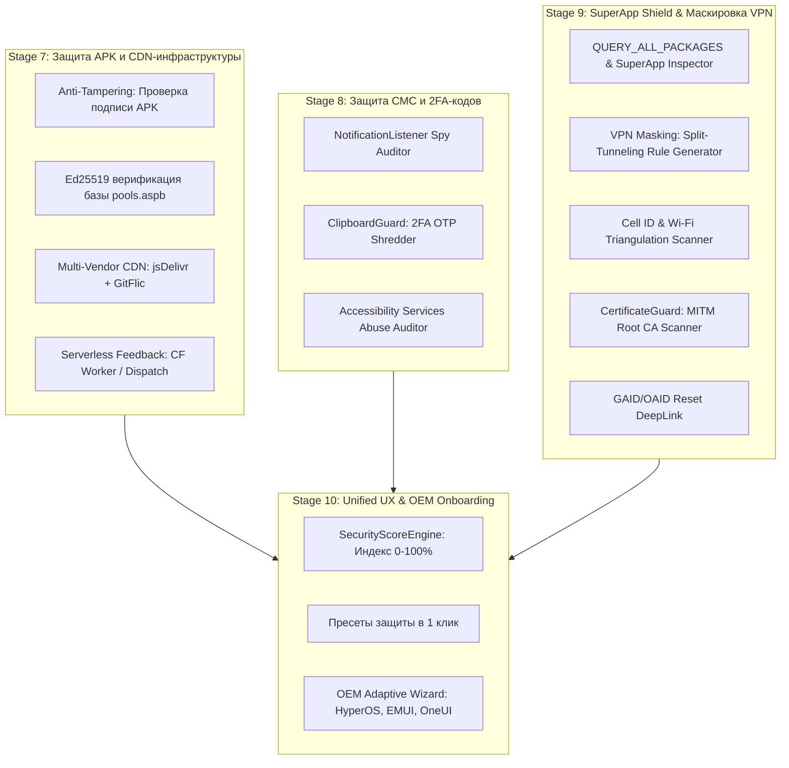
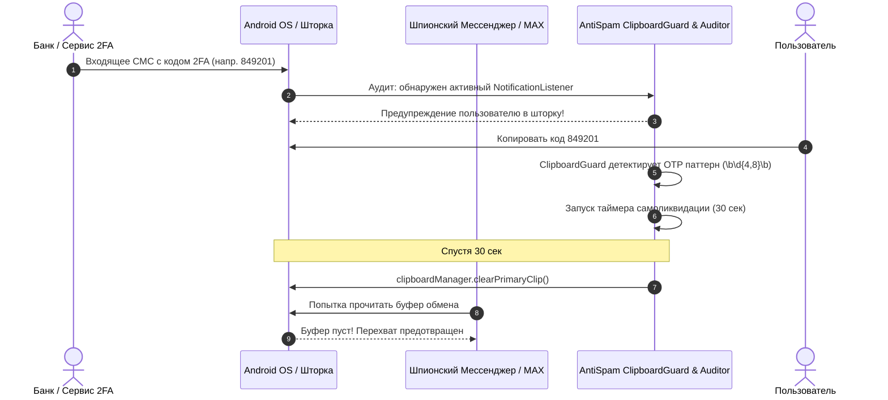
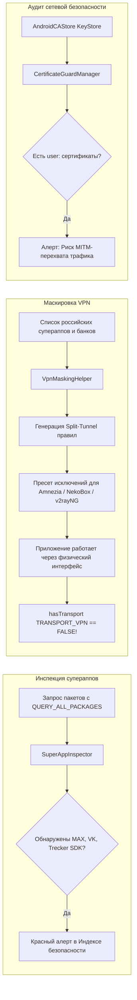
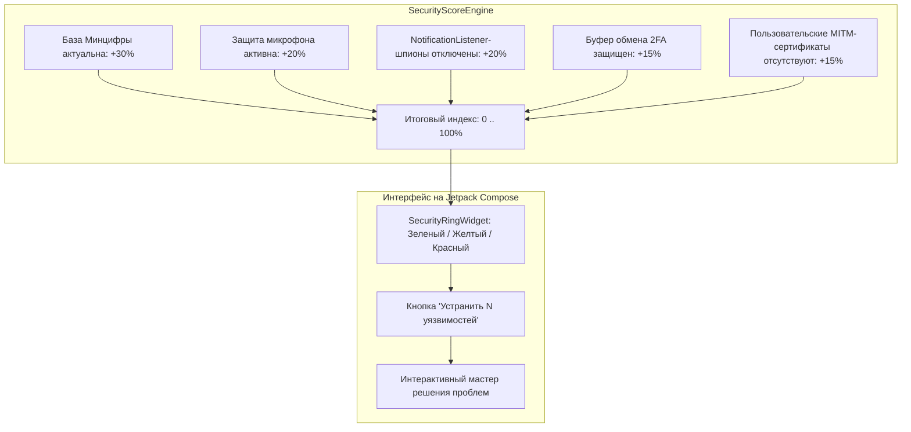

# План и Архитектурный Roadmap реализации «SuperApp & Spyware Shield» (Stage 7–10)

> **Основание:** Анализ экспертного заключения [code_expert_verdict_3.md](file:///d:/Antispam/code_expert_verdict_3.md)  
> **Версия системы:** v1.1.0  
> **Цель:** Защита инфраструктуры AntiSpam, нейтрализация шпионских модулей российских супераппов (MAX, трекеры MyTracker/AppMetrica), защита СМС/2FA-кодов, маскировка VPN и создание единого понятного UX («Индекс безопасности 0–100%»).

---

## 1. Архитектурная диаграмма связей новых контуров

---

## 2. Декомпозиция этапов по фазам и функциям

---

### STAGE 7: Защита APK, криптографическая верификация базы и отказоустойчивый CDN

#### Фаза 7.1: Anti-Tampering и самозащита приложения
*Цель: Блокировка модифицированных/пиратских сборок, запрет дампа базы через ADB и предотвращение захвата конфиденциальных экранов.*

1. **Функция `AntiTamperHelper.verifyAppSignature(context: Context): SignatureVerificationResult`**
   * *Файл:* `android/app/src/main/java/ru/antispam/app/security/AntiTamperHelper.kt`
   * *Логика:*
     - Получает сертификат подписи через `packageManager.getPackageInfo(packageName, PackageManager.GET_SIGNING_CERTIFICATES)`.
     - Рассчитывает SHA-256 хеш байтов сертификата.
     - Сравнивает с эталонным отпечатком `DB:C8:12:B2:09:1C:2A:BE:35:75:35:72:53:4D:96:69:34:8D:07:4C:88:50:8C:14:09:EA:48:F1:0D:AD:D1:C8`.
     - В случае несовпадения возвращает `SignatureVerificationResult.TAMPERED`.
2. **Функция `AntiTamperHelper.enforceSecureWindow(activity: Activity)`**
   * *Логика:* Вызывает `activity.window.setFlags(WindowManager.LayoutParams.FLAG_SECURE, WindowManager.LayoutParams.FLAG_SECURE)` на экранах Сейфа звонков (`CallLogScreen`), блокируя скриншоты и захват экрана через `MediaProjection`.
3. **Обновление манифеста [AndroidManifest.xml](file:///d:/Antispam/android/app/src/main/AndroidManifest.xml):**
   - Установка `android:allowBackup="false"` и `android:fullBackupContent="false"` для предотвращения извлечения зашифрованных баз `vault_call_records` через `adb backup`.
4. **Юнит-тесты:**
   - `AntiTamperHelperTest.kt`: Проверка корректности валидации эталонного SHA-256 и отсечения тестовых debug-сертификатов.

---

#### Фаза 7.2: Асимметричная подпись Ed25519 для базы `pools.aspb`
*Цель: Математическая гарантия неизменности бинарного файла пулов, исключающая MITM-подмену или компрометацию CDN.*

1. **Python-скрипт генерации ключей и подписи:**
   * *Файл:* `backend/crypto_signer.py`
   * *Функция `generate_ed25519_keypair() -> tuple[bytes, bytes]`*: Создает приватный ($32$ байта) и публичный ($32$ байта) ключи с помощью библиотеки `cryptography.hazmat.primitives.asymmetric.ed25519`.
   * *Функция `sign_aspb_file(file_path: Path, private_key_bytes: bytes) -> bytes`*: Вычисляет 64-байтную цифровую подпись Ed25519 от тела файла `pools.aspb` и записывает заголовок расширенного формата `ASPB v2` (16 байт стандартный заголовок + 64 байта подпись Ed25519 + тело).
2. **Встраивание публичного ключа в клиент:**
   * *Файл:* `android/app/build.gradle.kts`
   * Экспорт `buildConfigField("String", "ED25519_PUBLIC_KEY", "\"<HEX_PUBLIC_KEY>\"")`.
3. **Функция `AspbCryptoVerifier.verifyAspbSignature(payload: ByteArray, publicKeyHex: String): Boolean`**
   * *Файл:* `android/app/src/main/java/ru/antispam/app/security/AspbCryptoVerifier.kt`
   * *Логика:* Проверяет подпись первых $N$ байт через Java Ed25519 API (`java.security.Signature.getInstance("Ed25519")` на Android 13+ или легковесную встроенную криптографическую реализацию).
4. **Интеграция в [SyncRepository.kt](file:///d:/Antispam/android/app/src/main/java/ru/antispam/app/data/repository/SyncRepository.kt):**
   * Перед вызовом `db.withTransaction { insertAll(...) }` валидирует подпись. При нарушении целостности файл отбрасывается с записью в лог `SECURITY_INTEGRITY_BREACH`.

---

#### Фаза 7.3: Multi-Vendor CDN и устойчивость к блокировкам ТСПУ
*Цель: Обеспечение доступности обновлений базы даже при замедлении или блокировке `github.com` в мобильных сетях РФ.*

1. **Расширение списка зеркал `DEFAULT_CDN_URLS` в [SyncRepository.kt](file:///d:/Antispam/android/app/src/main/java/ru/antispam/app/data/repository/SyncRepository.kt#L62):**
   - Зеркало 1: `https://github.com/Mishakorobov/Antispam/releases/download/latest-data/pools.aspb` (GitHub Releases)
   - Зеркало 2: `https://cdn.jsdelivr.net/gh/Mishakorobov/Antispam@main/data/pools.aspb` (jsDelivr CDN — нейтральная глобальная сеть)
   - Зеркало 3: `https://raw.githubusercontent.com/Mishakorobov/Antispam/main/data/pools.aspb` (GitHub Raw)
2. **Шаг зеркалирования в [.github/workflows/sync_registry.yml](file:///d:/Antispam/.github/workflows/sync_registry.yml):**
   - Добавление зеркалирования артефактов в ветку `cdn-mirror` для ускоренной отдачи через jsDelivr без задержек инвалидации кэша.

---

#### Фаза 7.4: Бессерверный шлюз краудсорсинговых жалоб (Serverless Crowdsourcing Bridge)
*Цель: Сбор жалоб пользователей на новые спам-номера без аренды платного сервера.*

1. **Cloudflare Worker (Zero-Cost Ingestion):**
   * *Файл:* `deploy/cf_worker_report_bridge.js`
   * Принимает POST `/api/v1/report` от клиентов AntiSpam.
   * Агрегирует репорты в Cloudflare KV / D1 или отправляет коммит в репозиторий `data/crowd_reports/`.
2. **Функция `SyncRepository.flushPendingReportsToBridge(deviceHash: String)`**
   * Отправляет накопившиеся локальные жалобы из `db.pendingReportDao().getPending()` на бесплатный URL Cloudflare Worker (`https://antispam-bridge.workers.dev/report`).

---

### STAGE 8: Контур защиты СМС и 2FA («SMS & OTP Privacy Shield»)

#### Фаза 8.1: Детектор шпионов шторки уведомлений (`NotificationListenerAuditor`)
*Цель: Выявление приложений (включая мессенджер MAX), читающих СМС-сообщения банков и одноразовые пуш-коды из шторки.*

1. **Модель данных `NotificationSpyApp`:**
   * *Файл:* `android/app/src/main/java/ru/antispam/app/privacy/model/NotificationSpyApp.kt`
   * Поля: `packageName: String`, `appName: String`, `componentName: String`, `isSystemApp: Boolean`, `riskLevel: PrivacyRiskLevel`.
2. **Функция `NotificationListenerAuditor.detectActiveListeners(context: Context): List<NotificationSpyApp>`**
   * *Файл:* `android/app/src/main/java/ru/antispam/app/privacy/NotificationListenerAuditor.kt`
   * *Логика:*
     - Читает строку `Settings.Secure.getString(context.contentResolver, "enabled_notification_listeners")`.
     - Парсит разделенные двоеточием компоненты `package/service`.
     - Сопоставляет пакеты с базой известных трекеров, банков и супераппов (MAX, VK, банковские SDK).
     - Помечает сторонние мессенджеры с данным правом как **CRITICAL RISK**.
3. **Функция `NotificationListenerAuditor.openSettingsRevokeIntent(context: Context)`**
   * Возвращает `Intent(Settings.ACTION_NOTIFICATION_LISTENER_SETTINGS)` для отключения шпиона пользователем в 1 тап.
4. **Юнит-тесты:**
   - `NotificationListenerAuditorTest.kt`: Проверка парсинга строкового реестра `enabled_notification_listeners` и фильтрации системных служб от сторонних супераппов.

---

#### Фаза 8.2: Автоматический шредер 2FA-кодов в буфере обмена (`ClipboardGuardManager`)
*Цель: Очистка временных кодов авторизации и паролей из буфера обмена до того, как открытый суперапп их украдет.*

1. **Функция `ClipboardGuardManager.startGuard(context: Context)`**
   * *Файл:* `android/app/src/main/java/ru/antispam/app/privacy/ClipboardGuardManager.kt`
   * Регистрирует `ClipboardManager.OnPrimaryClipChangedListener`.
2. **Функция `ClipboardGuardManager.inspectAndScheduleShred(clipData: ClipData?)`**
   * *Логика:*
     - Проверяет тип данных на текст.
     - Сопоставляет с регулярными выражениями OTP: `val OTP_REGEX = Regex("\\b\\d{4,8}\\b")` и паттернами паролей/токенов.
     - Если обнаружен короткоживущий код подтверждения — запускает корутину с задержкой $30$ секунд.
     - По истечении таймера вызывает `clipboardManager.clearPrimaryClip()` (Android 10+) или заменяет буфер пустой строкой.
     - Выводит ненавязчивый `Toast` / уведомление: *«🔒 Одноразовый код стерт из буфера обмена в целях безопасности»*.
3. **Функция `ClipboardGuardManager.stopGuard()`**: Отменяет слушатель и сбрасывает активные таймеры при закрытии.

---

#### Фаза 8.3: Аудитор злоупотреблений Спецвозможностями (`AccessibilityAuditor`)
*Цель: Выявление приложений, которые могут перехватывать экран, читать текст в других мессенджерах (Telegram, Signal) и автоматически кликать.*

1. **Функция `AccessibilityAuditor.getSuspiciousAccessibilityServices(context: Context): List<AccessibilitySpyReport>`**
   * *Файл:* `android/app/src/main/java/ru/antispam/app/privacy/AccessibilityAuditor.kt`
   * Читает `Settings.Secure.getString(context.contentResolver, Settings.Secure.ENABLED_ACCESSIBILITY_SERVICES)`.
   * Исключает проверенные сервисы для людей с ограниченными возможностями (TalkBack, Select to Speak).
   * Если стороннее приложение (клавиатура, суперапп, оптимизатор) включено в доступ — присваивает наивысший уровень угрозы.
2. **Функция `AccessibilityAuditor.createRevokeIntent(): Intent`**
   * Формирует `Intent(Settings.ACTION_ACCESSIBILITY_SETTINGS)`.

---

### STAGE 9: SuperApp Shield, маскировка VPN и инспекция скрытой телеметрии

#### Фаза 9.1: Инспектор тотального сканирования системы (`SuperAppInspector`)
*Цель: Выявление приложений, использующих разрешение `QUERY_ALL_PACKAGES` для каталогизации всех программ на смартфоне.*

1. **Функция `SuperAppInspector.scanPackagesWithQueryAll(context: Context): List<PackagePrivacyProfile>`**
   * *Файл:* `android/app/src/main/java/ru/antispam/app/privacy/SuperAppInspector.kt`
   * Перебирает установленные приложения через `packageManager.getInstalledPackages(PackageManager.GET_PERMISSIONS)`.
   * Проверяет наличие `android.permission.QUERY_ALL_PACKAGES` в `requestedPermissions`.
   * Анализирует, читает ли приложение приватный список VPN-клиентов и утилит обхода.

---

#### Фаза 9.2: Мастер скрытия активного VPN (`VpnMaskingHelper`)
*Цель: Маскировка факта использования VPN от приложений, проверяющих `hasTransport(TRANSPORT_VPN)` или наличие `tun0`.*

1. **Реестр целевых пакетов российских супераппов и банков:**
   * *Файл:* `android/app/src/main/java/ru/antispam/app/privacy/model/RussianAppRegistry.kt`
   * Список: `ru.vk.max`, `com.vkontakte.android`, `ru.sberbankmobile`, `ru.tcsbank.mbank`, `ru.vtb24.mobilebanking`, `ru.rostel`, `com.gosuslugi` и др.
2. **Функция `VpnMaskingHelper.generateSplitTunnelConfig(context: Context, format: VpnClientFormat): String`**
   * *Файл:* `android/app/src/main/java/ru/antispam/app/privacy/VpnMaskingHelper.kt`
   * Сканирует телефон и отбирает установленные пакеты из реестра.
   * Генерирует готовый конфиг исключений:
     - Для **AmneziaVPN**: список имен пакетов для вкладки «Раздельное туннелирование» (Исключить приложения).
     - Для **v2rayNG / NekoBox**: конфигурационный фрагмент маршрутизации `bypass-apps`.
3. **Функция `VpnMaskingHelper.copyConfigToClipboardWithGuide(context: Context, format: VpnClientFormat)`**
   * Копирует список в буфер и показывает диалоговое окно со скриншотами настройки выбранного VPN-клиента.

---

#### Фаза 9.3: Сканер скрытой геолокации без GPS (`GeoTriangulationAuditor`)
*Цель: Выявление приложений, определяющих физический адрес пользователя по Cell ID вышек сотовой связи и BSSID соседних Wi-Fi роутеров.*

1. **Функция `GeoTriangulationAuditor.auditLocationAndWifiPermissions(context: Context): List<TriangulationRiskApp>`**
   * *Файл:* `android/app/src/main/java/ru/antispam/app/privacy/GeoTriangulationAuditor.kt`
   * Находит приложения, обладающие одновременно правами:
     - `ACCESS_FINE_LOCATION` (или `ACCESS_COARSE_LOCATION`)
     - `ACCESS_WIFI_STATE` (доступ к списку BSSID роутеров)
     - `READ_PHONE_STATE` (доступ к Cell ID сотовой вышки).
   * Выводит предупреждение: *«Приложение способно вычислять ваше местоположение с точностью до квартиры без включения GPS»*.

---

#### Фаза 9.4: Инспектор корневых сертификатов (`CertificateGuardManager`)
*Цель: Защита от скрытого перехвата HTTPS-трафика через поддельные Root CA.*

1. **Функция `CertificateGuardManager.inspectUserCertificates(): List<UserInstalledCertificate>`**
   * *Файл:* `android/app/src/main/java/ru/antispam/app/privacy/CertificateGuardManager.kt`
   * Инициализирует системное хранилище `KeyStore.getInstance("AndroidCAStore")`.
   * Перебирает псевдонимы сертификатов (`aliases()`).
   * Находит все сертификаты с префиксом `user:` (установленные вручную или сторонними утилитами).
   * Извлекает `SubjectDN`, `IssuerDN`, дату истечения и SHA-256 отпечаток.
   * При обнаружении недоверенного CA бьет тревогу: *«Обнаружен пользовательский сертификат перехвата трафика!»*.
2. **Функция `CertificateGuardManager.getSecuritySettingsIntent(): Intent`**
   * Формирует переход в `Settings.ACTION_SECURITY_SETTINGS` (или `TRUSTED_CREDENTIALS_USER`).

---

#### Фаза 9.5: Сброс сквозного рекламного трекера (`AdIdManager`)
*Цель: Разрыв связи между действиями пользователя в разных приложениях через GAID/OAID.*

1. **Функция `AdIdManager.openAdvertisingSettings(context: Context): Boolean`**
   * *Файл:* `android/app/src/main/java/ru/antispam/app/privacy/AdIdManager.kt`
   * Вызывает системный `Intent("com.google.android.gms.settings.ADS_PRIVACY")` либо стандартный `Intent(Settings.ACTION_APPLICATION_DETAILS_SETTINGS)`.

---

### STAGE 10: Единый UX-индекс безопасности (0–100%) и адаптивный OEM-онбординг

#### Фаза 10.1: Движок расчета индекса защищенности (`SecurityScoreEngine`)
*Цель: Сведение десятков технических проверок к одному наглядному баллу 0–100%.*

1. **Модель `SecurityAuditSummary`:**
   * *Файл:* `android/app/src/main/java/ru/antispam/app/ui/privacy/model/SecurityAuditSummary.kt`
   * Поля: `totalScore: Int (0..100)`, `grade: SecurityGrade (CRITICAL, MODERATE, SECURE)`, `issues: List<SecurityIssue>`.
2. **Функция `SecurityScoreEngine.calculateSecurityScore(context: Context): Flow<SecurityAuditSummary>`**
   * *Файл:* `android/app/src/main/java/ru/antispam/app/ui/privacy/SecurityScoreEngine.kt`
   * *Весовая формула:*
     - Актуальность базы номеров ($\le 7$ дней): $+30$ баллов.
     - Активность защиты микрофона `MicGuardService`: $+20$ баллов.
     - Отсутствие опасных слушателей шторки `NotificationListener`: $+20$ баллов.
     - Активный шредер буфера обмена `ClipboardGuard`: $+15$ баллов.
     - Отсутствие MITM Root CA сертификатов: $+15$ баллов.
3. **UI-компонент `SecurityRingWidget` (Compose Canvas):**
   * *Файл:* `android/app/src/main/java/ru/antispam/app/ui/components/SecurityRingWidget.kt`
   * Круговой анимированный градиентный индикатор с крупной цифрой процента и кнопкой быстрого устранения узких зон.

---

#### Фаза 10.2: Пресеты комплексной защиты в 1 клик
*Цель: Мгновенное переключение уровня паранойи пользователя.*

1. **Модель `ProtectionPreset` (Enum):**
   - `BASIC_COMFORT`: Только блокировка спама и ВЦИОМ + режим «Жду курьера».
   - `ANTI_EAVESDROPPING`: Базовый + `MicGuard`, `MicJammer`, `ClipboardGuard`.
   - `MAX_BUNKER`: Все функции + `PrivateCallLogVault` + скрытие уведомлений.
2. **Функция `SettingsViewModel.applyProtectionPreset(preset: ProtectionPreset)`**
   * Включает или выключает соответствующие сервисы в одной транзакции `SharedPreferences`.

---

#### Фаза 10.3: Адаптивный OEM-мастер онбординга (`OemOnboardingHelper`)
*Цель: 100% выживаемость фоновых служб на агрессивных китайских прошивках.*

1. **Функция `OemOnboardingHelper.detectOem(): OemVendor`**
   * *Файл:* `android/app/src/main/java/ru/antispam/app/util/OemOnboardingHelper.kt`
   * Определяет вендора: `XIAOMI_HYPEROS`, `HUAWEI_EMUI`, `SAMSUNG_ONEUI`, `VIVO_ORIGINOS`, `GENERIC_AOSP`.
2. **Функция `OemOnboardingHelper.getAutostartSettingsIntent(context: Context): Intent?`**
   * Возвращает специализированный Intent для вендорских экранов «Автозапуск» (`com.miui.securitycenter`, `com.huawei.systemmanager`, `com.vivo.permissionmanager`).
3. **UI-карточка `OemBatteryOptimizationBanner`:**
   * Показывается в настройках только если вендор агрессивно глушит фоновые задачи, с визуальной инструкцией для конкретной модели.

---

## 3. Сводный график реализации (Release Roadmap)

| Этап / Фаза | Сроки | Ключевые файлы / Задачи | Результат |
| :--- | :---: | :--- | :--- |
| **Stage 7** (Инфраструктура & Ed25519) | 1–2 день | `AntiTamperHelper.kt`, `crypto_signer.py`, `AspbCryptoVerifier.kt`, Multi-CDN | APK защищен от перепаковки, база защищена криптографической подписью |
| **Stage 8** (Защита СМС и 2FA) | 3–4 день | `NotificationListenerAuditor.kt`, `ClipboardGuardManager.kt`, `AccessibilityAuditor.kt` | Шпионы шторки уведомлений обезврежены, OTP-коды стираются через 30 сек |
| **Stage 9** (SuperApp Shield & VPN) | 5–6 день | `SuperAppInspector.kt`, `VpnMaskingHelper.kt`, `CertificateGuardManager.kt` | Скрытие VPN от банков, детекция сканирования программ, MITM Root CA |
| **Stage 10** (UX Индекс & OEM) | 7–8 день | `SecurityScoreEngine.kt`, `SecurityRingWidget.kt`, `OemOnboardingHelper.kt` | Индекс защищенности (0–100%), пресеты в 1 клик, адаптивный онбординг |
| **Релиз v1.1.0** | 9 день | Полное регрессионное тестирование (Android + Backend), выпуск сборки | Обновление во всех 8 магазинах приложений |
