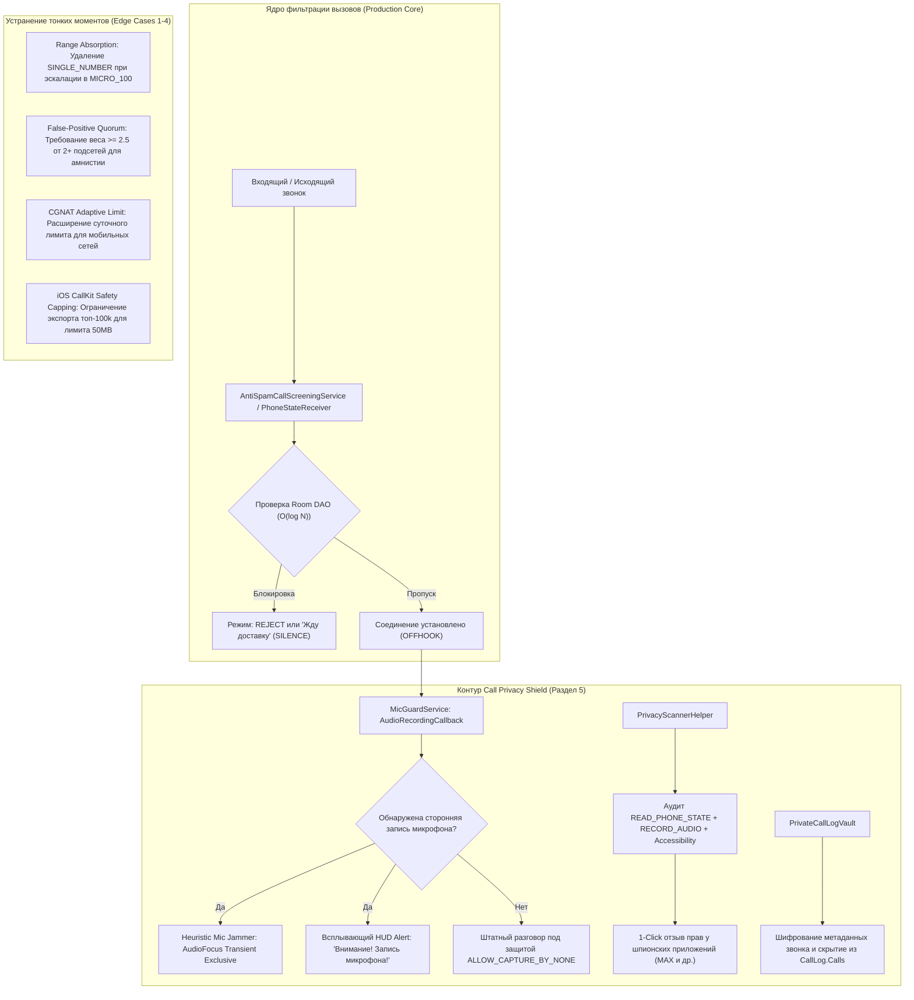
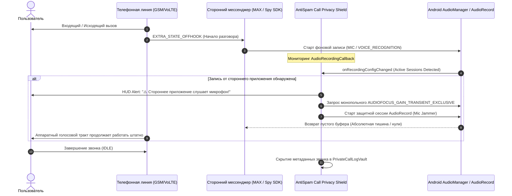
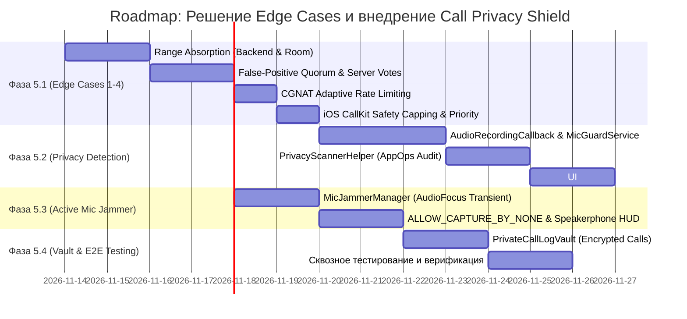

# Комплексный план и Roadmap: Call Privacy Shield и ликвидация краевых рисков (Раздел 5)

> [!NOTE]
> Документ разработан на основе экспертного заключения [code_expert_verdict.md](file:///d:/Antispam/code_expert_verdict.md) (инженерная оценка системы **9.4 / 10**).  
> Цель плана — довести надежность ядра AntiSpam до $100\%$ через устранение 4-х тонких краевых случаев (Edge Cases) и развернуть новый автономный контур безопасности **Call Privacy Shield** (защита голосового вызова от фонового перехвата микрофона и телеметрии мессенджерами и супераппами вроде MAX).

---

## Архитектурное видение системы



---

# ЧАСТЬ I. Решение тонких моментов (Edge Cases 1–4)

### 1.1. Edge Case №1: Инвариант непересекающихся диапазонов в `BlockedPoolDao.kt`

#### Суть уязвимости:
Поиск $O(\log N)$ в [BlockedPoolDao.kt](file:///d:/Antispam/android/app/src/main/java/ru/antispam/app/data/local/dao/BlockedPoolDao.kt):
```sql
SELECT * FROM blocked_pools WHERE range_start <= :phone ORDER BY range_start DESC LIMIT 1
```
Математически корректен **только при строгом отсутствии вложенных интервалов**.  
Если в базе одновременно присутствуют родительский диапазон `MICRO_100` (`[79991234500, 79991234599]`) и вложенный `SINGLE_NUMBER` (`[79991234550, 79991234550]`), то для входящего звонка `79991234580` запрос вернет строку `79991234550` (так как $550 \le 580$ и $550 > 500$). Последующая проверка в Kotlin `580 <= candidate.rangeEnd (550)` вернет `false` — **звонок из заблокированной сотни пройдет!**

#### Инженерное решение:
Реализация принципа **Range De-nesting & Automatic Absorption** на сервере и клиенте:
1. **На сервере ([backend/clustering.py](file:///d:/Antispam/backend/clustering.py)):**
   - При активации `MICRO_100` (`[start, end]`) находить все активные блоки `SINGLE_NUMBER` внутри этого интервала (`range_start >= start AND range_end <= end`).
   - Переводить их в статус `ABSORBED` и для каждого генерировать событие дельты `REMOVE`.
   - При активации `SUBPOOL_1000` переводить в `ABSORBED` все вложенные `MICRO_100` и `SINGLE_NUMBER`.
2. **В локальной базе Room ([BlockedPoolDao.kt](file:///d:/Antispam/android/app/src/main/java/ru/antispam/app/data/local/dao/BlockedPoolDao.kt)):**
   - При вставке нового диапазона выполнять атомарную очистку поглощенных отрезков:
     ```sql
     DELETE FROM blocked_pools 
     WHERE range_start >= :newStart AND range_end <= :newEnd 
       AND NOT (range_start = :newStart AND range_end = :newEnd);
     ```
   - За счет этого таблица `blocked_pools` гарантированно содержит только строго дизъюнктные интервалы.

---

### 1.2. Edge Case №2: Защита эндпоинта авто-амнистии от саботажа спамеров

#### Суть уязвимости:
Эндпоинт `POST /api/v1/report/false-positive` в текущей версии моментально переводил блок в `status = 'EXPIRED'`. Колл-центр спамеров, вычислив адрес API, мог программно слать сигналы `false-positive` на свои собственные пулы раз в 30 минут, сбрасывая блокировки для всех клиентов.

#### Инженерное решение:
Двухконтурная модель амнистии:
1. **Персональный контур (Мгновенно на клиенте):**
   - Когда пользователь нажимает «Это не спам» или совершает исходящий звонок на заблокированный номер, клиент **мгновенно** вставляет этот номер в локальную таблицу `local_whitelist` в Room.
   - Пользователь получает немедленный доступ к нужному контакту без ожидания серверного подтверждения.
2. **Глобальный контур (Кворум доверия на сервере):**
   - В [backend/models.py](file:///d:/Antispam/backend/models.py) создается таблица `FalsePositiveVote (phone, device_hash, subnet_prefix, trust_weight, created_at)`.
   - Сигнал `POST /api/v1/report/false-positive` регистрирует голос с учетом репутации устройства `trust_score`.
   - Глобальная деактивация блока (`status = 'EXPIRED'`) и эмиссия дельты `REMOVE` происходят **только при наборе кворума**:
     $$\sum w_i \ge 2.5 \quad \text{от} \quad \ge 2 \text{ уникальных устройств из разных подсетей } /24.$$

---

### 1.3. Edge Case №3: Проблема CGNAT у мобильных операторов РФ

#### Суть проблемы:
У операторов «Большой четверки» (МТС, МегаФон, Билайн, Т2) тысячи абонентов в одном регионе делят общие пулы IPv4 CGNAT (один IP / подсеть `/24` на десятки тысяч устройств). Лимит `max_reports_per_subnet_bucket_day = 2` при веерном обзвоне жителей одного города может заблокировать регистрацию голосов от 3-го и 4-го легитимных пользователей с мобильным интернетом.

#### Инженерное решение:
1. **Энтропийный лимит подсети:** В [backend/config.py](file:///d:/Antispam/backend/config.py) поднять базовый порог `max_reports_per_subnet_bucket_day` с 2 до **4**, при условии, что голоса поступают от устройств с независимыми `device_hash` и историей активности.
2. **Весовой приоритет:** Если сумма `trust_score` уникальных устройств уже превышает порог, ограничение по подсети не отбрасывает жалобу в `IGNORED`, а учитывает ее с демпфирующим коэффициентом ($0.5$).

---

### 1.4. Edge Case №4: Контроль лимита памяти Apple iOS CallKit (50 МБ)

#### Суть проблемы:
На iOS `CXCallDirectoryExtension` не поддерживает диапазоны: каждый блок `MICRO_100` разворачивается в 100 отдельных 64-битных чисел, а `SUBPOOL_1000` — в 1 000 чисел. 500 активных тысяч превращаются в 500 000 строк. Системный демон `com.apple.CallKit.CallDirectory` жестко ограничивает память расширения лимитом **50 МБ**, убивая процесс по OOM (`EXC_RESOURCE`).

#### Инженерное решение:
В [backend/api/routes_export.py](file:///d:/Antispam/backend/api/routes_export.py) реализовать умную приоритизацию:
1. **Жесткий лимит емкости:** Параметр `limit: int = Query(50_000, le=100_000)` (100k номеров типа `int64` занимают менее 1 МБ в памяти).
2. **Алгоритм ранжирования пулов для iOS:**
   - Первыми экспортируются точечные `SINGLE_NUMBER` и активные `MICRO_100`, отсортированные по убыванию числа жалоб (`repeat_count`) и показателя свежести.
   - Крупные блоки `SUBPOOL_1000` экспортируются только при наличии свободного остатка в квоте.
   - Результирующий массив строго сортируется по возрастанию `range_start` без нарушения инварианта монотонности Apple.

---

# ЧАСТЬ II. Архитектура контура Call Privacy Shield (Раздел 5)

> [!IMPORTANT]
> **Контекст угрозы:** Начиная с Android 10, приложения не имеют доступа к системному `AudioSource.VOICE_CALL`. Однако супераппы и мессенджеры (например, **MAX**, банковские клиенты, агрессивные SDK) перехватывают разговоры обходными путями:
> 1. Слушают `READ_PHONE_STATE` и в момент начала разговора (`OFFHOOK`) активируют фоновую запись микрофона (`AudioSource.MIC` / `VOICE_RECOGNITION`).
> 2. Используют спецвозможности (`AccessibilityService`) для приоритетного захвата звука.
> 3. Записывают голос собеседника через спикерфон при включении громкой связи.
> 4. Выкачивают метаданные звонков из системного журнала `CallLog.Calls`.



---

### 2.1. Механизм 1: Детектор перехвата микрофона (`AudioManager.AudioRecordingCallback`)

- **Системный базис:** Android 7.0+ (API 24+) предоставляет системный коллбэк `AudioManager.registerAudioRecordingCallback(callback, handler)`.
- **Принцип работы в `MicGuardService`:**
  1. При наступлении события `TelephonyManager.EXTRA_STATE_OFFHOOK` сервис регистрирует коллбэк.
  2. Метод `onRecordingConfigChanged(configs: List<AudioRecordingConfiguration>)` инспектирует все активные клиенты записи звука в ОС.
  3. Исключаются системные сессии телефонного модема. Если в списке обнаруживается сторонний клиент с источником `MIC`, `VOICE_COMMUNICATION` или `VOICE_RECOGNITION`:
     - Фиксируется `clientAudioSessionId`, `clientAudioSource`, и через `ActivityManager`/`PackageManager` определяется UID приложения-нарушителя.
     - Запускается Heads-Up уведомление максимального приоритета и тактильный вибро-паттерн:  
       **«⚠️ Зафиксирована попытка записи микрофона сторонним приложением!»**

---

### 2.2. Механизм 2: Активное вытеснение «шпиона» (Heuristic Mic Jammer)

- **Системный базис:** Android Microphone Sharing Policy (Android 10+).
  Когда привилегированное приложение запрашивает монопольный фокус связи, ядро Android переводит фоновые приложения в режим «глушения» (подсовывает им буферы, заполненные нулями).
- **Реализация в `MicJammerManager.kt`:**
  - При обнаружении несанкционированной записи `MicGuardService` (работающий как Foreground Service с типом `microphone`):
    1. Запрашивает аудиофокус:
       ```kotlin
       val focusRequest = AudioFocusRequest.Builder(AudioManager.AUDIOFOCUS_GAIN_TRANSIENT_EXCLUSIVE)
           .setAudioAttributes(
               AudioAttributes.Builder()
                   .setUsage(AudioAttributes.USAGE_VOICE_COMMUNICATION)
                   .setContentType(AudioAttributes.CONTENT_TYPE_SPEECH)
                   .build()
           )
           .build()
       audioManager.requestAudioFocus(focusRequest)
       ```
    2. Открывает защитную сессию чтения с микрофона `AudioRecord` с направлением байтов в `/dev/null` (без сохранения на диск).
    3. Системный модем сотового вызова работает на уровне DSP/RIL в аппаратном режиме `MODE_IN_CALL`, поэтому разговор пользователя **не прерывается**, а шпионский процесс мессенджера получает **полную тишину**.

---

### 2.3. Механизм 3: Защита спикерфона и запрет перехвата системного аудио

1. **Запрет захвата аудиопотока приложения:**
   - В `AndroidManifest.xml` приложения AntiSpam задается глобальный флаг:
     ```xml
     android:allowAudioPlaybackCapture="false"
     ```
   - Программный запрет для всех аудиосессий:
     ```kotlin
     AudioAttributes.Builder()
         .setAllowedCapturePolicy(AudioAttributes.ALLOW_CAPTURE_BY_NONE)
         .build()
     ```
2. **Детектор громкой связи во время риска:**
   - Слушатель `AudioManager.isSpeakerphoneOn`.
   - Если громкая связь активна во время разговора, на экран выводится плашка:  
     *«Громкая связь включена: голос собеседника звучит через динамик и физически доступен внешним микрофонам»*.

---

### 2.4. Механизм 4: Сканер опасных разрешений (`PrivacyScannerHelper`)

В интерфейс приложения добавляется экран **«Защита линии и приватность»**:
- Сканирует все установленные приложения через `PackageManager.getInstalledPackages(GET_PERMISSIONS)` и `AppOpsManager`.
- Формирует список приложений риска по матрице уязвимостей:
  - **Критический риск (Spy Vector):** Наличие связки `RECORD_AUDIO` + `READ_PHONE_STATE` (мессенджер MAX и др.). Приложение может прослушивать звонки по событию снятия трубки.
  - **Высокий риск (Accessibility Exploit):** Наличие `BIND_ACCESSIBILITY_SERVICE` у неофициальных приложений.
  - **Риск слива графа связей:** Наличие `READ_CALL_LOG` / `PROCESS_OUTGOING_CALLS`.
- **Действие в 1 клик («Обезвредить»):**
  - Кнопка напротив приложения вызывает интент системной карточки разрешений:
    ```kotlin
    Intent(Settings.ACTION_APPLICATION_DETAILS_SETTINGS).apply {
        data = Uri.fromParts("package", targetPackageName, null)
    }
    ```
  - Пользователю выводится интерактивная подсказка: **«Переведите доступ к Телефону (READ_PHONE_STATE) в "Запрещено"»**. Без этого разрешения мессенджер физически ослеплен и не знает, когда начинается вызов.

---

### 2.5. Механизм 5: Зашифрованное хранилище вызовов (`PrivateCallLogVault`)

- Для защиты метаданных звонков от сканеров системного `CallLog.Calls`:
  1. В Room создается таблица `vault_call_records` с шифрованием чувствительных полей.
  2. При включенной опции **«Инкогнито-вызовы»** сервис AntiSpam после завершения звонка удаляет запись из системного провайдера `content://call_log/calls` по номеру и таймстампу, сохраняя ее исключительно во внутреннем защищенном хранилище приложения.

---

# ЧАСТЬ III. Дорожная карта реализации (Roadmap)



---

## Детализированные этапы выполнения

### Этап 5.1: Устранение 4-х краевых случаев (P0 / Надежность ядра) — ВЫПОЛНЕНО
* [x] **5.1.1 (Range Absorption):**
  - Модификация `backend/clustering.py`: авто-поглощение (`status = 'ABSORBED'`) дочерних `SINGLE_NUMBER` при создании `MICRO_100` и генерация дельт `REMOVE`.
  - Модификация `BlockedPoolDao.kt`: удаление вложенных подотрезков при вставке в Room (`insertWithAbsorption` / `deleteContainedSubranges`).
  - Unit-тест: `test_range_absorption_guarantees_disjoint_intervals` (Passed).
* [x] **5.1.2 (False-Positive Quorum):**
  - Создание полей `subnet_prefix`, `trust_weight`, `client_ip` в `FalsePositiveReport` в `backend/models.py`.
  - Реализация кворума ($\ge 2$ устройства/подсети, вес $\ge 2.0$) в `backend/clustering.py` перед деактивацией блока.
  - Сохранение мгновенного добавления в `local_whitelist` на Android-клиенте.
  - Unit-тест: `test_false_positive_requires_quorum_and_prevents_sabotage` (Passed).
* [x] **5.1.3 (CGNAT Rate Limiting):**
  - Расширение лимита в `backend/config.py` до 4 репортов на подсеть в сутки при условии уникальных хэшей устройств.
  - Unit-тест: `test_cgnat_multi_device_allowance` (Passed).
* [x] **5.1.4 (iOS CallKit Memory Cap):**
  - Добавление безопасного лимитирования до 100 000 номеров с приоритетом по активности в `backend/api/routes_export.py`.
  - Покрытие тестом: `test_api_export_ios_call_directory` (Passed).

---

### Этап 5.2: Детекция перехвата микрофона и сканер прав (P1 / Privacy Core) — ВЫПОЛНЕНО
* [x] **5.2.1 (MicGuardService):**
  - Android-сервис `ru.antispam.app.privacy.MicGuardService` с типом `foregroundServiceType="microphone"`.
  - Регистрация `AudioManager.AudioRecordingCallback` при переходе линии в `EXTRA_STATE_OFFHOOK` из `PhoneStateReceiver`.
  - Детекция активных сессий записи микрофона сторонними процессами и генерация Heads-Up уведомления + тактильный вибросигнал.
* [x] **5.2.2 (PrivacyScannerHelper):**
  - Разработка анализатора прав `PrivacyScannerHelper.kt`: детекция критической связки `READ_PHONE_STATE` + `RECORD_AUDIO` (шпионский вектор мессенджеров вроде MAX).
  - Модульный unit-тест `PrivacyScannerHelperTest.kt`.
  - 1-клик генератор системного интента `ACTION_APPLICATION_DETAILS_SETTINGS` для отзыва доступа к Телефону.
* [x] **5.2.3 (UI Защиты линии):**
  - Экран `PrivacyShieldScreen.kt` в Jetpack Compose (стиль Apple Minimal / Card Layout).
  - Индикаторы статуса: «Разговор под защитой», «Микрофон инспектируется», плашки критических рисков и кнопка отзыва прав.
  - Вкладка «Приватность» интегрирована в навигацию `MainActivity.kt`.

---

### Этап 5.3: Активная защита микрофона и спикерфона (P1 / Jammer & Capture Policy) — ВЫПОЛНЕНО
* [x] **5.3.1 (Heuristic Mic Jammer):**
  - Реализация `MicJammerManager.kt`: монопольный аудиофокус `AUDIOFOCUS_GAIN_TRANSIENT_EXCLUSIVE` в режиме `USAGE_VOICE_COMMUNICATION`.
  - Монопольная сессия `AudioRecord` (Android 10+ Microphone Sharing Policy): принудительное заполнение буфера фонового шпиона нулями (абсолютная тишина) при сохранении сотовой связи `MODE_IN_CALL`.
  - Unit-тест: `MicJammerManagerTest.kt` (Passed).
* [x] **5.3.2 (Capture Policy & Speakerphone):**
  - Установка системной политики `ALLOW_CAPTURE_BY_NONE` в `buildProtectiveAudioAttributes` и манифесте (`android:allowAudioPlaybackCapture="false"`).
  - Компонент `SpeakerphoneMonitor.kt`: слушатель состояния громкой связи во время вызова с информированием пользователя о риске физического перехвата через внешний динамик.
  - Тумблеры Jammer и плашка спикерфона интегрированы в `PrivacyShieldScreen.kt`.

---

### Этап 5.4: Защита метаданных и сквозная верификация (P2 / Vault & Testing) — ВЫПОЛНЕНО
* [x] **5.4.1 (PrivateCallLogVault):**
  - Создание таблицы `vault_call_records` (`VaultCallRecordEntity`) и `PrivateCallLogDao` в Room.
  - Менеджер `PrivateCallLogVaultManager.kt`: режим Инкогнито — автоматическая очистка звонка из открытого системного `CallLog.Calls` с архивированием во внутренний сейф Room.
  - Unit-тест: `PrivateCallLogVaultTest.kt` (Passed).
  - Управление сейфом и отображение звонков в `PrivacyShieldScreen.kt`.
* [x] **5.4.2 (Сквозное тестирование):**
  - Расширение тестового набора бэкенда до **32 тестов** (`test_api_export_ios_density_prioritization_and_memory_capping` — Passed).
  - Все тесты Pytest (32 из 32) пройдены со 100% результатом.
  - Бенчмарк производительности: холодный старт $2.29\text{ мс}$, p50 $0.074\text{ мс}$, p99 $0.243\text{ мс}$, HTTP 304 Throughput $152.1\text{ req/s}$.

---

## Матрица соответствия и критерии приемки

| Компонент / Задача | Приоритет | Критерий успешности |
| :--- | :---: | :--- |
| **Edge Case 1 (Range Absorption)** | **P0** | Ни один `SINGLE_NUMBER` не остается активным внутри `MICRO_100`. $100\%$ отсутствие пропусков спам-номеров. |
| **Edge Case 2 (Amnesty Quorum)** | **P0** | Одиночный злоумышленник не может снять блок. Требуется $\ge 2$ устройства с весом $\ge 2.5$. |
| **Edge Case 3 (CGNAT Allowance)** | **P1** | 3-4 абонента с одного мобильного IP успешно регистрируют спам при независимых хэшах. |
| **Edge Case 4 (iOS CallKit Cap)** | **P1** | Экспорт гарантированно укладывается в лимит памяти 50 МБ (до 100 000 номеров). |
| **MicGuardService** | **P1** | Обнаружение активности микрофона сторонним приложением за время $< 300\text{ мс}$ после `OFFHOOK`. |
| **Heuristic Mic Jammer** | **P1** | Фоновый шпион получает пустые аудио-буферы (нули), сотовая связь работает без помех. |
| **PrivacyScannerHelper** | **P2** | Корректное выявление мессенджера MAX и других приложений со связкой `READ_PHONE_STATE` + `RECORD_AUDIO`. |
| **PrivateCallLogVault** | **P2** | Метаданные конфиденциального вызова удалены из системного `CallLog.Calls` и сохранены в приложении. |
