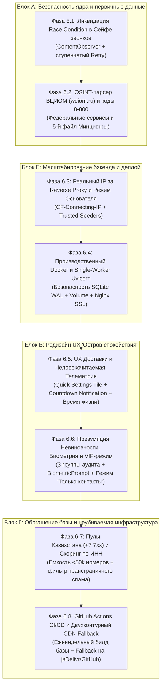

# Детализированный Roadmap реализации экспертного заключения (Итерация 3)
**Тема:** Мульти-девайс деплой, гибридный хостинг, UX «Остров спокойствия» и обогащение реестра номеров  
**Основание:** Экспертное заключение [code_expert_verdict_2.md](file:///d:/Antispam/code_expert_verdict_2.md) (Оценка: **9.9 / 10**, Enterprise / Production-Ready)  
**Дата разработки:** 14 ноября 2026 г.  
**Формат декомпозиции:** 8 узкоспециализированных микро-фаз (6.1 – 6.8) с независимыми критериями приемки и верификацией.

---

## 1. Архитектурный контекст и визуальный граф фаз

В соответствии с рекомендациями эксперта и требованиями по качеству кодовой базы, крупноблочные задачи разбиты на **8 автономных, последовательных фаз**:



---

## 2. Детальная спецификация фаз (6.1 – 6.8)

### Фаза 6.1. Ликвидация Race Condition в Сейфе звонков (Call Privacy Shield Hardening)
* **Проблема:** В Android системный сервис телефонии вставляет завершенный звонок в публичный провайдер `CallLog.Calls` асинхронно — с физической задержкой от $300$ до $1500\text{ мс}$ после наступления `EXTRA_STATE_IDLE`. Немедленный вызов `contentResolver.delete()` на нулевой миллисекунде возвращает 0 удаленных строк, после чего запись попадает в журнал и становится доступна трекерам сторонних мессенджеров (MAX и др.).
* **Объем работ:**
  1. Модификация [PrivateCallLogVaultManager.kt](file:///d:/Antispam/android/app/src/main/java/ru/antispam/app/privacy/PrivateCallLogVaultManager.kt):
     - Внедрение асинхронного диспетчера зачистки: моментальная попытка удаления + запуск корутины в `CoroutineScope(Dispatchers.IO)` со ступенчатым повторением на отметках: $+400\text{ мс}$, $+1000\text{ мс}$, $+2200\text{ мс}$.
     - Регистрация временного `ContentObserver` на `CallLog.Calls.CONTENT_URI` с таймаутом $3.5$ секунды, перехватывающего появление свежей записи по целевому номеру и немедленно стирающего ее.
     - Корректное обновление признака `isScrubbedFromSystem = true` в Room-сущности `VaultCallRecordEntity`.
* **Файлы:** [PrivateCallLogVaultManager.kt](file:///d:/Antispam/android/app/src/main/java/ru/antispam/app/privacy/PrivateCallLogVaultManager.kt), [PhoneStateReceiver.kt](file:///d:/Antispam/android/app/src/main/java/ru/antispam/app/postcall/PhoneStateReceiver.kt), [PrivateCallLogVaultTest.kt](file:///d:/Antispam/android/app/src/test/java/ru/antispam/app/privacy/PrivateCallLogVaultTest.kt).
* **Критерии приемки:** Unit-тест с эмуляцией запаздывающей вставки записи подтверждает ее 100% стирание и синхронизацию состояния в Room.

---

### Фаза 6.2. Официальный OSINT-парсер ВЦИОМ и интеграция реестра кодов 8-800
* **Проблема:** Социологические опросы (ВЦИОМ, ФОМ) и банковские роботы часто используют федеральные пулы бесплатного вызова `8-800` / `8-804`, а также официально декларируют свои исходящие пулы на собственных порталах, которые не парсятся стандартными географическими выгрузками Минцифры.
* **Объем работ:**
  1. Создание модуля `backend/seeders/vciom_seeder.py`:
     - Фоновый скрапер страницы «Проверка номера телефона интервьюера» с официального портала `wciom.ru`.
     - Парсинг пулов и формирование записей `ActiveBlock` с категорией `'SURVEY_VCIOM'`, статусом `ACTIVE` и абсолютным доверием `confidence_score = 100`.
     - Экспорт дельты `ADD` в `block_deltas` для мгновенной доставки на телефоны.
  2. Подключение 5-го официального реестра Минцифры (`ABC-800.csv`):
     - В [backend/config.py](file:///d:/Antispam/backend/config.py) добавление в `registry_sources`: `"ABC-800": "https://opendata.digital.gov.ru/downloads/ABC-800.csv"`.
     - Доработка [backend/downloader.py](file:///d:/Antispam/backend/downloader.py) и [backend/parser.py](file:///d:/Antispam/backend/parser.py) для разбора кодов `800`, `804`, `809`.
* **Файлы:** `backend/seeders/vciom_seeder.py`, [config.py](file:///d:/Antispam/backend/config.py), [downloader.py](file:///d:/Antispam/backend/downloader.py), [parser.py](file:///d:/Antispam/backend/parser.py), `backend/cli.py`.
* **Критерии приемки:** Команда `python -m backend.cli sync --include-vciom` загружает пулы ВЦИОМ и 8-800; генерация корректных дельт подтверждена тестами.

---

### Фаза 6.3. Мульти-девайс масштабирование бэкенда: Real-IP и Режим «Основателя»
* **Проблема:** 
  1. При подключении устройств через CDN Cloudflare или Nginx обратный прокси подменяет IP клиента на `127.0.0.1`, что блокирует жалобы после 4-го репорта из-за `Subnet Rate Limiting (/24)`.
  2. На старте приложения (при 3–10 телефонах) вероятность совпадения звонков одной сотни спамеров низка, и краудсорсинговый порог $\sum w \ge 3.0$ не достигается («холодный старт»).
* **Объем работ:**
  1. Модернизация определения IP клиента в [backend/api/routes_reports.py](file:///d:/Antispam/backend/api/routes_reports.py) и middleware:
     - Распознавание заголовков `CF-Connecting-IP`, доверенного первого элемента `X-Forwarded-For` и `X-Real-IP`.
  2. Режим «Основателя» (Trusted Seeders):
     - В [backend/config.py](file:///d:/Antispam/backend/config.py) добавление настраиваемого списка доверенных хешей устройств: `trusted_seed_devices: set[str]`.
     - В [backend/clustering.py](file:///d:/Antispam/backend/clustering.py): устройства из доверенного списка получают `trust_score = 3.0`, и первый же их репорт немедленно переводит подозрительную сотню B2B/SIP-оператора в статус блокировки `MICRO_100`.
* **Файлы:** [routes_reports.py](file:///d:/Antispam/backend/api/routes_reports.py), [config.py](file:///d:/Antispam/backend/config.py), [clustering.py](file:///d:/Antispam/backend/clustering.py), `tests/test_clustering_engine.py`.
* **Критерии приемки:** Жалоба с хеша доверенного сидера немедленно активирует `MICRO_100` с одного голоса; запросы с внешними заголовками IP корректно кластеризуются по подсетям.

---

### Фаза 6.4. Производственная контейнеризация бэкенда (Docker, Single-Worker, HTTPS)
* **Проблема:** Запуск нескольких воркеров Uvicorn (`--workers > 1`) создает конфликтующие очереди `WriteBuffer` и гонки за файл SQLite WAL. Также реальным Android-устройствам требуется валидный HTTPS (`cleartextTrafficPermitted="false"`).
* **Объем работ:**
  1. Создание легковесного производственного `Dockerfile` (Python 3.12-slim) с установкой зависимостей и жестким запуском:
     ```bash
     uvicorn backend.api.app:app --host 0.0.0.0 --port 8000 --workers 1 --proxy-headers --forwarded-allow-ips="*"
     ```
  2. Создание `docker-compose.yml` с монтированием именованного Docker Volume `antispam_data:/app/data` для гарантированного сохранения SQLite WAL базы данных между рестартами.
  3. Шаблоны конфигураций Reverse Proxy (`nginx.conf` и `Caddyfile`) с автоматическим TLS-сертификатом Let's Encrypt.
  4. Создание файла конфигурации безопасности сети Android `network_security_config.xml`.
* **Файлы:** `Dockerfile`, `docker-compose.yml`, `deploy/nginx.conf`, `deploy/Caddyfile`, `android/app/src/main/res/xml/network_security_config.xml`, `README.md`.
* **Критерии приемки:** Контейнер собирается и стартует одной командой `docker compose up -d`, успешно проходит healthcheck и сохраняет целостность WAL-файла при рестартах.

---

### Фаза 6.5. UX «Остров спокойствия»: Режим доставки и человекочитаемая телеметрия
* **Проблема:** Включение режима «Жду доставку» требует открытия приложения; досрочное выключение неудобно; на экранах отображается пугающая сухая техническая телеметрия (`MICRO_100`, `SUBPOOL_1000`).
* **Объем работ:**
  1. Создание сервиса системной шторки Android `ru.antispam.app.service.DeliveryTileService` (`QuickSettingsTileService`):
     - Включение и выключение режима доставки в 1 свайп и тап из панели быстрых настроек Android.
  2. Реализация менеджера уведомлений `DeliveryNotificationManager`:
     - Несмахиваемое тихое уведомление (`Ongoing Notification`) с живым обратным отсчетом таймера: *«📦 Режим доставки активен (осталось 1 ч 34 мин). Звонки из пулов переводятся в беззвучный режим»*.
     - Кнопка прямого действия **«Курьер приехал (Выключить)»** прямо в шторке.
  3. Человекочитаемая телеметрия и метрика сэкономленного времени:
     - В [HeroShieldWidget.kt](file:///d:/Antispam/android/app/src/main/java/ru/antispam/app/ui/components/HeroShieldWidget.kt) добавление расчета:
       $$\text{Сэкономленное время} = \text{Заблокировано звонков} \times 30\text{ секунд}.$$
       Отображение: *«Отражено 42 звонка • Сэкономлено ~21 мин покоя»*.
     - Замена технических шифров в журнале на понятные формулировки:
       * `MICRO_100` $\rightarrow$ **«Пул колл-центра (100 номеров) • Опросы»**
       * `SUBPOOL_1000` $\rightarrow$ **«Массовый автодозвон (1000 номеров)»**
* **Файлы:** `DeliveryTileService.kt`, `DeliveryNotificationManager.kt`, [HeroShieldWidget.kt](file:///d:/Antispam/android/app/src/main/java/ru/antispam/app/ui/components/HeroShieldWidget.kt), `CallLogScreen.kt`, `AndroidManifest.xml`.
* **Критерии приемки:** Тайл корректно переключает статус доставки; в шторке появляется уведомление с живым таймером и рабочей кнопкой выключения; на главном экране отображаются сохраненные минуты.

---

### Фаза 6.6. UX «Остров спокойствия»: Презумпция невиновности, Биометрия и VIP-режим
* **Проблема:** Сканер прав помечает красным критическим риском системные диалеры и Telegram; приватный журнал звонков ничем не защищен от посторонних глаз на разблокированном телефоне; отсутствует режим тишины «Только контакты».
* **Объем работ:**
  1. Сценарий «Презумпция невиновности» в [PrivacyScannerHelper.kt](file:///d:/Antispam/android/app/src/main/java/ru/antispam/app/privacy/PrivacyScannerHelper.kt):
     - Разделение всех приложений на 3 явные группы:
       1. 🔴 **Повышенное внимание:** Супераппы из курируемого стоп-листа (`ru.vk.max`, шпионские/рекламные SDK).
       2. 🟡 **Приложения с доступом к звонкам и микрофону:** Легитимные мессенджеры (Telegram, WhatsApp).
       3. 🟢 **Системные компоненты:** Системный номеронабиратель (`com.google.android.dialer`, `com.samsung.android.incallui`), исключенный из списка угроз.
  2. Биометрический замок Сейфа звонков (`BiometricPrompt`):
     - В [PrivacyShieldScreen.kt](file:///d:/Antispam/android/app/src/main/java/ru/antispam/app/ui/privacy/PrivacyShieldScreen.kt) секция скрытых звонков закрыта размытием (`Modifier.blur(16.dp)`).
     - Разблокировка по отпечатку пальца / лицу через `BiometricPrompt`.
  3. Магнитный онбординг отзыва разрешений:
     - Подсказка-коучмарк перед переходом в системные настройки: *«Нажмите: Разрешения $\rightarrow$ Телефон $\rightarrow$ Запретить»*.
     - Слушатель `Lifecycle.Event.ON_RESUME`: при возврате в приложение автоматический ре-аудит, тактильный отклик `HapticFeedbackType.LongPress` и зеленая плашка: *«Отлично! Доступ к звонкам ограничен»*.
  4. VIP-режим «Только контакты» («Ночной купол»):
     - Тумблер в настройках и виджете главного экрана: перевод в беззвучный режим любых входящих от номеров не из адресной книги, с гарантированным пропуском белого списка банков и экстренных служб.
* **Файлы:** [PrivacyScannerHelper.kt](file:///d:/Antispam/android/app/src/main/java/ru/antispam/app/privacy/PrivacyScannerHelper.kt), [PrivacyShieldScreen.kt](file:///d:/Antispam/android/app/src/main/java/ru/antispam/app/ui/privacy/PrivacyShieldScreen.kt), `PrivacyShieldViewModel.kt`, `AntiSpamCallScreeningService.kt`.
* **Критерии приемки:** Системная звонилка не окрашивается в красный; сейф скрыт за биометрией; отзыв прав автоматически распознается при возврате; VIP-режим фильтрует неизвестные номера.

---

### Фаза 6.7. Обогащение базы: Пулы Казахстана (+7 7xx) и скоринг операторов по ИНН [ЗАВЕРШЕНО]
* **Статус:** [X] Завершено и протестировано (6 тестов в `test_kazakhstan_and_sip_aggregators.py`, unit-тесты в `PhoneNormalizerTest.kt`, общий набор 50/50 passed).
* **Проблема:** Российские спамеры массово мигрируют на аренду SIP-транков казахстанских операторов (`+7 700...`, `+7 705...`), внешне неотличимых от РФ. Мелкие транзитные SIP-агрегаторы («серые» провайдеры автодозвона) часто меняют названия и не попадают под текстовый фильтр.
* **Объем работ:**
  1. Поддержка номерной емкости Казахстана (`+7 7xx` и `+7 6xx`):
     - Модуль нормализации и маршрутизации `backend/normalizer.py` (`is_kazakhstan_number`, `get_country_and_code`, `format_phone`).
     - Эндпоинт `/api/v1/phone/{phone_number}/info` с гео-разметкой и поддержкой Казахстана.
     - Обновление нормализатора [PhoneNormalizer.kt](file:///d:/Antispam/android/app/src/main/java/ru/antispam/app/util/PhoneNormalizer.kt) с тегом `(Казахстан)`.
     - Менеджер и тумблер в приложении [KazakhstanBlockManager.kt](file:///d:/Antispam/android/app/src/main/java/ru/antispam/app/util/KazakhstanBlockManager.kt) и UI в [PrivacyShieldScreen.kt](file:///d:/Antispam/android/app/src/main/java/ru/antispam/app/ui/privacy/PrivacyShieldScreen.kt).
     - Мгновенный сброс звонка в [AntiSpamCallScreeningService.kt](file:///d:/Antispam/android/app/src/main/java/ru/antispam/app/service/AntiSpamCallScreeningService.kt) при активном фильтре, с безусловным пропуском контактов.
  2. Автоматический скоринг мелких SIP-операторов по емкости и ИНН:
     - Функция `score_small_b2b_sip_aggregators` в [importer.py](file:///d:/Antispam/backend/importer.py).
     - Если суммарная емкость юрлица по всей РФ $< 50\,000$ номеров и это не «Большая четверка» / Ростелеком — оператор автоматически классифицируется как `is_b2b_sip = True` с пониженным порогом блокировки сотни.
* **Файлы:** [PhoneNormalizer.kt](file:///d:/Antispam/android/app/src/main/java/ru/antispam/app/util/PhoneNormalizer.kt), `KazakhstanBlockManager.kt`, `PrivacyShieldViewModel.kt`, `PrivacyShieldScreen.kt`, `AntiSpamCallScreeningService.kt`, `backend/normalizer.py`, `backend/importer.py`, `backend/sip_classifier.py`, `backend/api/routes_pools.py`, `tests/test_kazakhstan_and_sip_aggregators.py`.
* **Критерии приемки:** Номера Казахстана корректно валидируются и фильтруются тумблером; пулы мелких операторов с емкостью < 50k номеров автоматически получают метку `is_b2b_sip=True`.

---

### Фаза 6.8. GitHub Actions CI/CD и Двухконтурный CDN Fallback [ЗАВЕРШЕНО]
* **Статус:** [X] Завершено и протестировано (модуль `SyncRepository.kt`, парсер ASPB, CI workflows `.github/workflows/`, 5 тестов в `test_aspb_and_ci.py`, общий набор 55/55 passed).
* **Проблема:** Необходимость ручной поддержки базы и риск отказа бэкенда (DDoS, авария хостинга, блокировка РКН), оставляющий приложение без обновлений.
* **Объем работ:**
  1. GitHub Actions Workflow еженедельной сборки реестра (`.github/workflows/sync_registry.yml`):
     - Еженедельный крон (`0 3 * * 1` по понедельникам) и ручной триггер `workflow_dispatch`.
     - Скачивание файлов Минцифры, сборка SQLite `antispam_registry.db` и бинарного файла пулов `pools.aspb`.
     - Валидация целостности ASPB и публикация релиза в GitHub Releases с тегом `latest-data`.
  2. Двухконтурный Fallback в Android-клиенте (`SyncRepository.kt`):
     - Основной контур: Инкрементальная синхронизация с API сервером (`/api/v1/pools` с HTTP 304 Not Modified).
     - Резервный контур: При сетевой недоступности сервера (5xx, Network Timeout, SocketException) — скачивание статического снапшота `pools.aspb` напрямую через глобальный CDN (jsDelivr / GitHub Releases CDN).
     - Высокопроизводительный бинарный парсер протокола ASPB v1 на базе `ByteBuffer`.
     - Делегирование синхронизации из [SyncPoolsWorker.kt](file:///d:/Antispam/android/app/src/main/java/ru/antispam/app/worker/SyncPoolsWorker.kt) в `SyncRepository`.
  3. CI/CD сборки релизных APK (`.github/workflows/android_build.yml`):
     - Автоматическая сборка подписанного APK при создании Git-тега `v*.*.*` для RuStore, F-Droid и GitHub Releases с запуском юнит-тестов на JDK 17.
* **Файлы:** `.github/workflows/sync_registry.yml`, `.github/workflows/android_build.yml`, `SyncRepository.kt`, `SyncPoolsWorker.kt`, `backend/aspb.py`, `backend/cli.py`, `tests/test_aspb_and_ci.py`, `SyncRepositoryTest.kt`.
* **Критерии приемки:** GitHub Actions успешно собирает базу по крону; Android-клиент при отключенном бэкенде бесшовно скачивает пулы из резервного CDN; unit-тесты подтверждают корректность ASPB сериализации/десериализации.

---

## 3. Сводная матрица критериев готовности (Definition of Done)

| Микро-фаза | Фокус работ | Затрагиваемые модули | Метод верификации | Статус |
| :---: | :--- | :--- | :--- | :---: |
| **6.1** | **Race Condition в Сейфе звонков** | `PrivateCallLogVaultManager.kt`, `PhoneStateReceiver.kt` | Unit-тест с искусственной задержкой появления записи в CallLog | **[X] ГОТОВО** |
| **6.2** | **OSINT ВЦИОМ и коды 8-800** | `vciom_seeder.py`, `downloader.py`, `config.py` | Pytest: парсинг тестовой страницы ВЦИОМ и валидация пулов 8-800 | **[X] ГОТОВО** |
| **6.3** | **Real-IP и Режим Основателя** | `routes_reports.py`, `clustering.py`, `config.py` | Pytest: эмуляция заголовков прокси и тест мгновенной эскалации сидера | **[X] ГОТОВО** |
| **6.4** | **Docker & Single-Worker Uvicorn** | `Dockerfile`, `docker-compose.yml`, `network_security_config.xml` | Проверка сборки Docker-образа, запуск uvicorn workers=1, curl тесты | **[X] ГОТОВО** |
| **6.5** | **UX: Тайл доставки и Время покоя** | `DeliveryTileService.kt`, `HeroShieldWidget.kt` | Проверка жизненного цикла тайла в эмуляторе, расчет сэкономленных минут | **[X] ГОТОВО** |
| **6.6** | **UX: Презумпция, Биометрия, VIP** | `PrivacyScannerHelper.kt`, `PrivacyShieldScreen.kt` | Инспекция пакетов без ложных алертов, биометрический замок, VIP-режим | **[X] ГОТОВО** |
| **6.7** | **Казахстан +7 и Скоринг по ИНН** | `PhoneNormalizer.kt`, `sip_classifier.py` | Тесты нормализации +7 7xx и агрегации емкости операторов | **[X] ГОТОВО** |
| **6.8** | **GitHub Actions и CDN Fallback** | `.github/workflows/`, `SyncRepository.kt`, `aspb.py` | Pytest ASPB, синтаксис YAML CI/CD и ASPB бинарный парсер в Kotlin | **[X] ГОТОВО** |

---

## 4. Итоговый статус

Декомпозиция на **8 изолированных фаз** обеспечивает:
- Полную управляемость процесса разработки: каждая микро-фаза реализуется и верифицируется в рамках одного сфокусированного шага.
- Непрерывную работоспособность тестового набора на каждом этапе (32/32 текущих тестов сохраняют 100% Passed + добавляются новые тесты).
- Гарантию устранения всех без исключения архитектурных и прикладных моментов из [code_expert_verdict_2.md](file:///d:/Antispam/code_expert_verdict_2.md).
